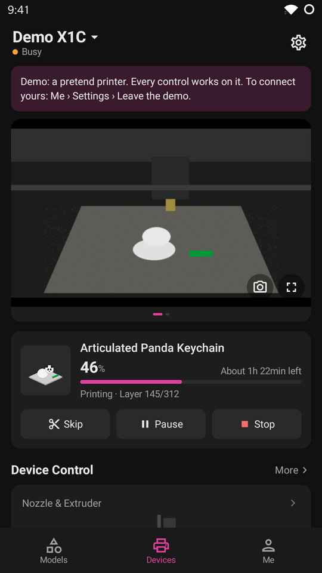
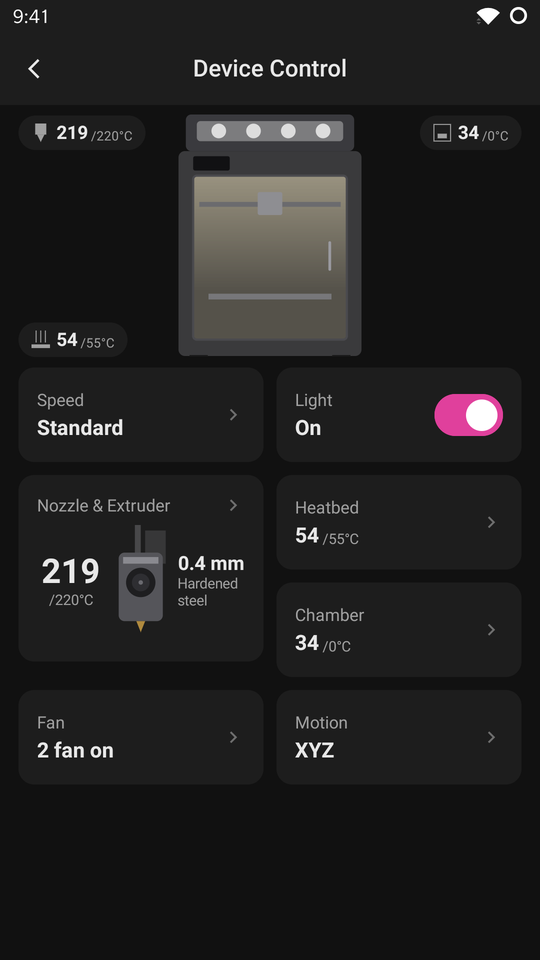
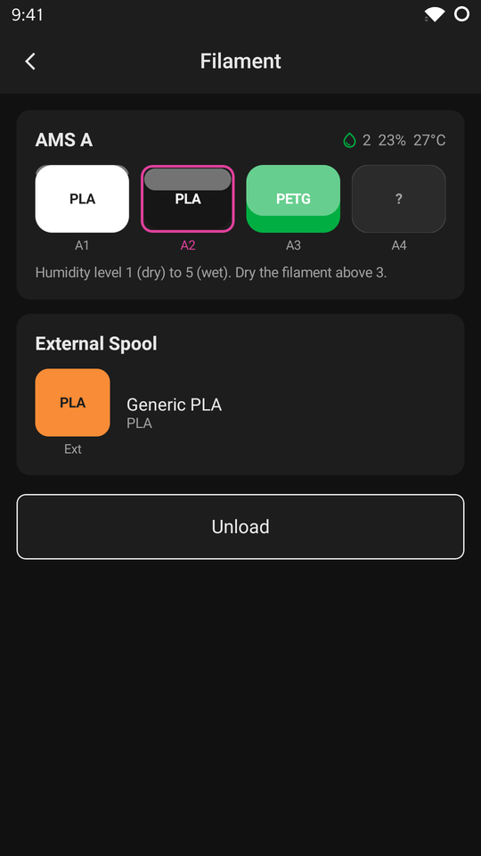
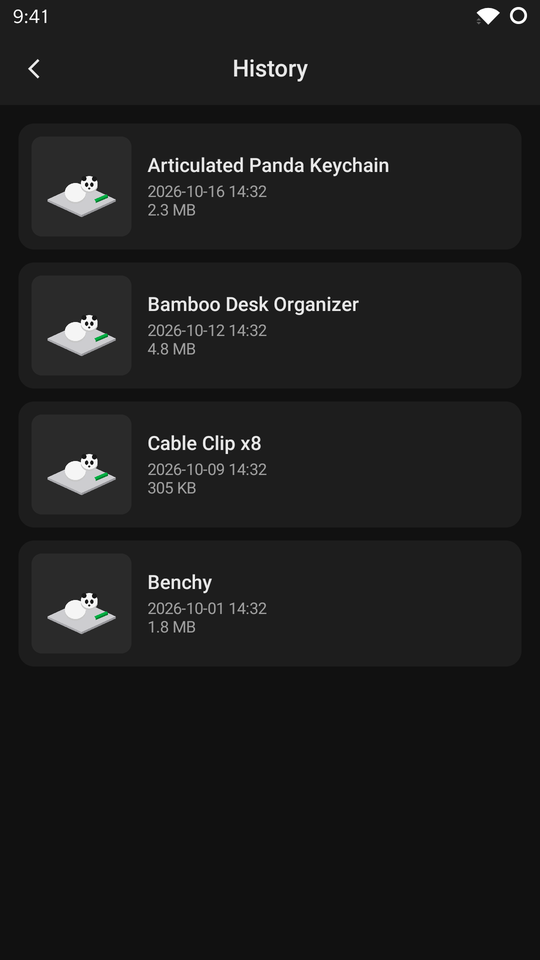
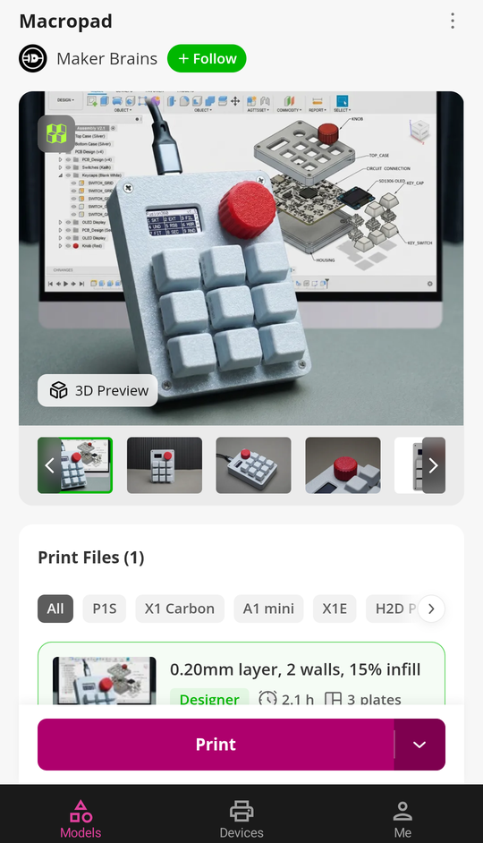
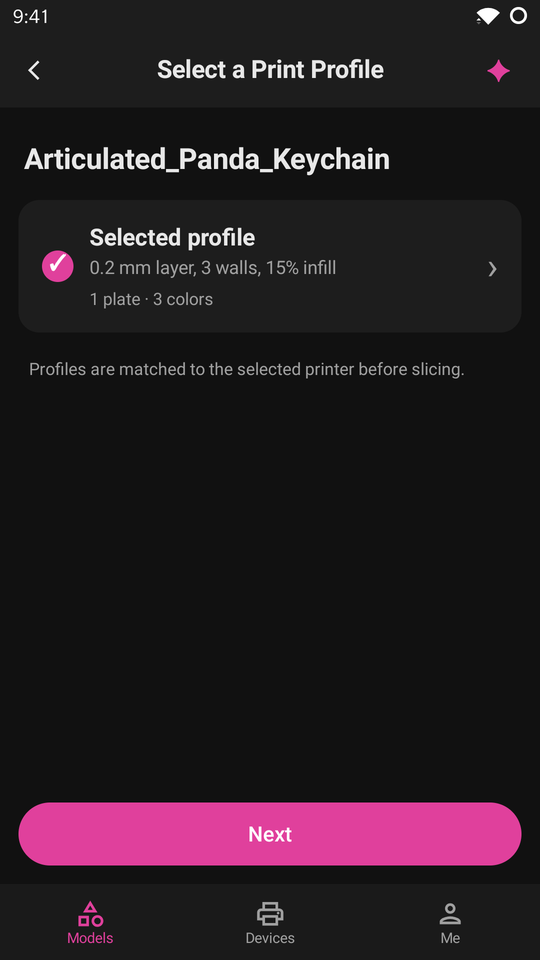
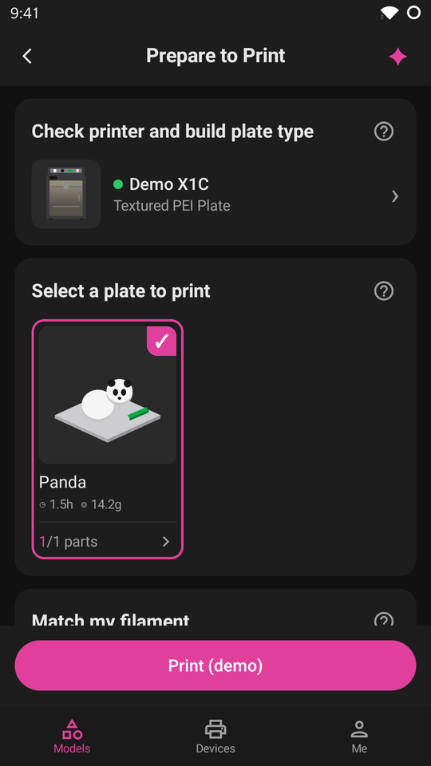
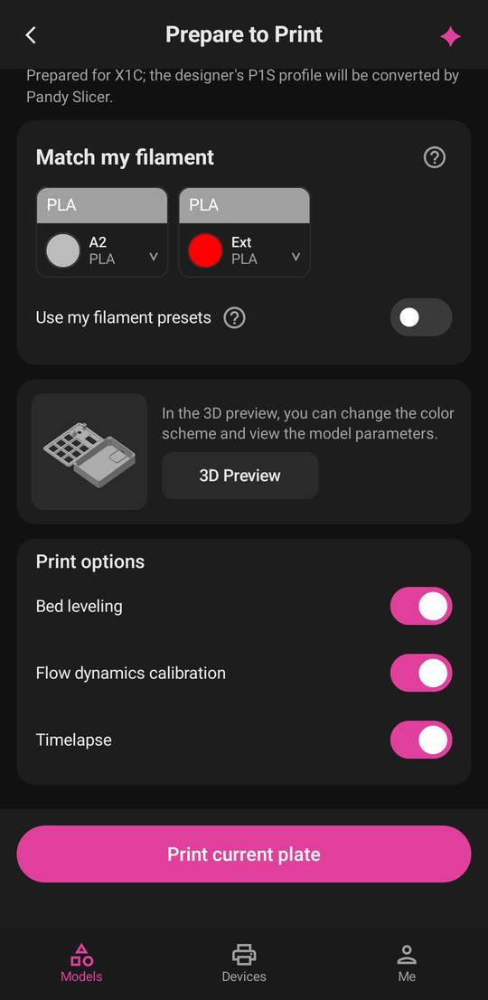

# Pandy

[](https://github.com/gccammelli/pandy/actions/workflows/build.yml)
[](https://codecov.io/gh/gccammelli/pandy)
[](https://github.com/gccammelli/pandy/releases/latest)
[](LICENSE)
[](https://github.com/gccammelli/pandy/issues)

**An unofficial companion app for Bambu printers in LAN-only mode.**

Pandy was built from scratch for people who keep their Bambu printer in LAN-only mode but still want useful printer
features. It talks directly to the printer on the local network, without sending printer control through
Bambu's cloud.

These are dark-mode screens from the built-in demo printer, which lets you explore the app without a printer:

<p align="center">
  
  
  
  
</p>

<p align="center">
  
  
  
  
</p>

## Features

- Printer status, progress, temperatures, fans, light, speed, motion controls and HMS messages
- Pause, stop and skip controls, plus AMS and filament controls
- Print files, thumbnails, history, reprints and timelapses
- Android: alerts when a print finishes, fails or needs attention, even with the screen off (Pandy stays connected in the background; turn it off in Settings). iOS can't watch in the background, so it has no alerts
- MakerWorld browsing, and printing its models with [Pandy Slicer](https://github.com/gccammelli/pandy-slicer) (a Home Assistant add-on that Pandy reaches through Home Assistant, or a Docker container; [how](docs/slicer.md))
- Light and dark themes, with a built-in demo printer

## Direct mode

Direct mode is the default and keeps printer traffic on your LAN. You need:

- A Bambu printer with **LAN Only Mode** and **Developer Mode** enabled
- Its **access code**
- A phone on the same network as the printer

If the printer does not appear automatically, enter its IP address and serial number. iPhone users normally need to
do this because iOS restricts the multicast announcements used for discovery.

See [the setup guide](docs/setup.md) for the printer-specific steps.

## Home Assistant is optional

Home Assistant with the [Bambu Lab integration](https://github.com/greghesp/ha-bambulab) can enhance Pandy when you
want more than a local connection. For example, it can provide:

- Access to the printer while you are away from home, through your Home Assistant remote access
- Print history, files and timelapses retained in Home Assistant's cache
- A camera bridge for printer models whose direct camera stream is not available on iOS
- Home Assistant automations and notifications based on printer state

You can add Home Assistant as an extra source while keeping direct printer control, or use it as Pandy's connection.
See [the setup guide](docs/setup.md) for both options.
Use a dedicated non-administrator Home Assistant user for Pandy's long-lived token; it can do whatever that user can. The Pandy Slicer add-on is the exception and needs an administrator user.

## Install

[](https://github.com/gccammelli/pandy/releases/latest/download/pandy.apk)
[](https://github.com/gccammelli/pandy/releases/latest/download/pandy.ipa)

Download the latest release for [Android or iOS](https://github.com/gccammelli/pandy/releases/latest).

- Android: install the APK.
- iPhone: install the unsigned IPA with [iLoader](https://iloader.app/), [SideStore](https://sidestore.io) or
  [AltStore](https://altstore.io), signed with your own Apple ID. Pandy is not on the App Store or Google Play.

## Build

```bash
./gradlew assembleDebug
./gradlew testDebugUnitTest
```

Pandy is Kotlin Multiplatform with Compose: shared screens and logic live in `shared/`, Android in `app/`, and iOS in
`iosApp/`. On Linux, the iOS source can be checked with:

```bash
./gradlew :shared:compileKotlinIosArm64 -Ppandy.ios
```

Pandy is not made by or affiliated with Bambu Lab. Protocol details and Bambu's CA certificates come from the
[Home Assistant Bambu Lab integration](https://github.com/greghesp/ha-bambulab) (MIT). [Pandy Slicer](https://github.com/gccammelli/pandy-slicer)
uses [Bambu Studio](https://github.com/bambulab/BambuStudio) (AGPL-3.0), unmodified in its own container.

Developed by Giancarlo Cammelli. MIT licence.

## Contributing

Bug reports, feature requests and pull requests are welcome. See [CONTRIBUTING.md](CONTRIBUTING.md) for tests, privacy rules and the required before/after visual evidence for user-facing changes.

## Support Pandy

[](https://buymeacoffee.com/cammelli)

### Coverage checks

CI enforces at least **95% line coverage** for the shared Android debug code, using Kover. The only exclusion is the Compose-generated `io.github.gccammelli.pandy.res` package: resource accessors and collectors produced under `shared/build/generated/compose/resourceGenerator/`. These are generated resource lookup tables and wrappers, rather than application decisions. Handwritten UI, demo behavior, networking, storage, encryption and device logic remain measured. Run the full automated suite and gate locally:

```sh
./gradlew testDebugUnitTest :shared:koverXmlReportDebug :shared:koverVerifyDebug
```

The report is `shared/build/reports/kover/reportDebug.xml`. Tests include simulated service boundaries and Robolectric screens; physical devices and iOS execution are separate checks.
