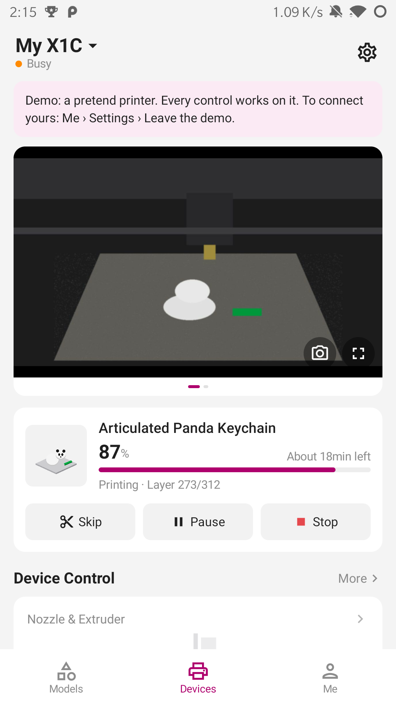
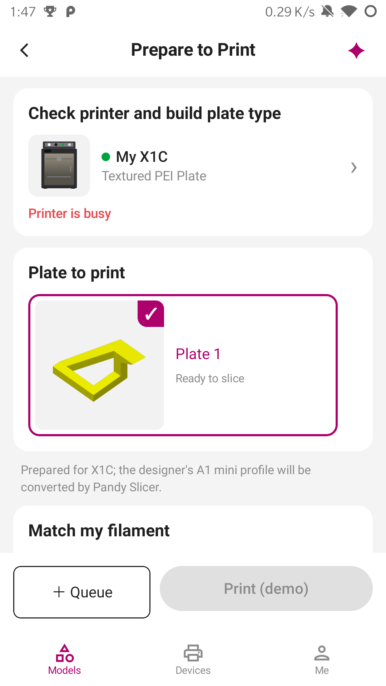

# Pandy

[](https://buymeacoffee.com/cammelli)

**Bambu Handy for printers in LAN-only mode.**

Pandy was built from scratch for people who keep their Bambu printer in LAN-only mode but still want the Handy
features they love. It talks directly to the printer on the local network, without sending printer control through
Bambu's cloud.

These are demo-mode screens; the demo printer lets you explore the app without a printer:

<p align="center">
  
  
</p>

## Features

- Printer status, progress, temperatures, fans, light, speed, motion controls and HMS messages
- Pause, stop and skip controls, plus AMS and filament controls
- Print files, thumbnails, history, reprints and timelapses
- MakerWorld browsing and print profiles when [Pandy Slicer](docs/slicer.md) is configured
- Light and dark themes, with a built-in demo printer

## Direct mode

Direct mode is the default and keeps printer traffic on your LAN. You need:

- A Bambu printer with **LAN Only Mode** and **Developer Mode** enabled
- Its **access code**
- A phone on the same network as the printer

If the printer does not appear automatically, enter its IP address and serial number. iPhone users normally need to
do this because iOS restricts the multicast announcements used for discovery.

See [the setup guide](docs/setup.md) for the printer-specific steps.

## Home Assistant is optional

Home Assistant with the [Bambu Lab integration](https://github.com/greghesp/ha-bambulab) can enhance Pandy when you
want more than a local connection. For example, it can provide:

- Access to the printer while you are away from home, through your Home Assistant remote access
- Print history, files and timelapses retained in Home Assistant's cache
- A camera bridge for printer models whose direct camera stream is not available on iOS
- Home Assistant automations and notifications based on printer state

You can add Home Assistant as an extra source while keeping direct printer control, or use it as Pandy's connection.
See [the setup guide](docs/setup.md) for both options.

## Install

Download the latest release for [Android or iOS](https://github.com/gccammelli/pandy/releases/latest).

- Android: install the APK.
- iPhone: install the IPA with [iLoader](https://iloader.app/), [SideStore](https://sidestore.io) or
  [AltStore](https://altstore.io), signed with your own Apple ID. Pandy is not on the App Store.

## Build

```bash
./gradlew assembleDebug
./gradlew testDebugUnitTest
```

Pandy is Kotlin Multiplatform with Compose: shared screens and logic live in `shared/`, Android in `app/`, and iOS in
`iosApp/`. On Linux, the iOS source can be checked with:

```bash
./gradlew :shared:compileKotlinIosArm64 -Ppandy.ios
```

Pandy is not made by or affiliated with Bambu Lab. Protocol details and Bambu's CA certificates come from the
[Home Assistant Bambu Lab integration](https://github.com/greghesp/ha-bambulab) (MIT). Pandy Slicer uses
[Bambu Studio](https://github.com/bambulab/BambuStudio) (AGPL-3.0), unmodified in its own container.

Developed by Giancarlo Cammelli. MIT licence.
