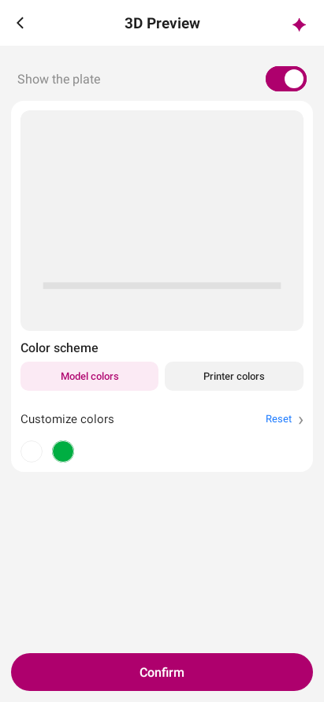
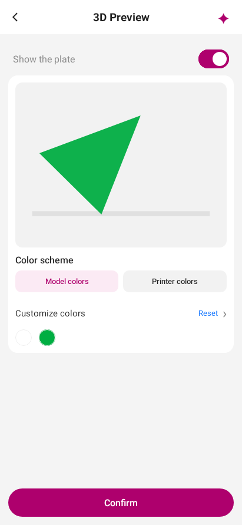

# 3MF preview transform regression

The new geometry assertions found an incorrect identity matrix: inline meshes with no transform collapsed into a line. The corrected identity preserves X, Y and Z, so the same three-vertex test project displays its triangle.

These are actual Robolectric Compose screenshots, not physical printer or phone validation. The same `ScreenTest.makerWorldProjectCanBePreparedAndPreviewedWithoutPrinting` fixture and renderer produced both images; only the identity matrix differs. No print command is sent by this scenario.

| Before (original matrix) | After (corrected matrix) |
| --- | --- |
|  |  |

To capture the current behavior:

```sh
PANDY_PREVIEW_EVIDENCE=/tmp/pandy-preview.png ./gradlew :shared:testDebugUnitTest --tests '*ScreenTest.makerWorldProjectCanBePreparedAndPreviewedWithoutPrinting'
```

`PreviewMeshTest` asserts actual vertex coordinates for missing/invalid transforms and for composed transforms. It also checks malformed references, cycles and the 20,000-triangle limit.
